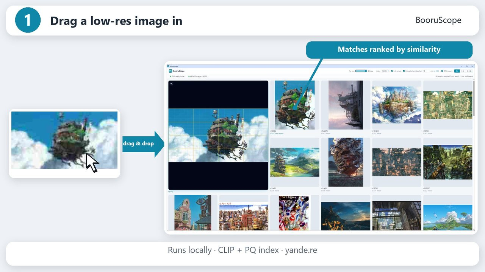

# BooruScope



Find the booru post behind a low-resolution image. Drop a picture into BooruScope, get a wall of visually similar [yande.re](https://yande.re) posts, and double-click a card to open that post in your browser.

BooruScope runs entirely on your computer. It embeds the dropped image with CLIP ViT-L/14, searches a downloaded product-quantized (PQ) index of yande.re posts, and can refine the ranking with an optional int8 vector file.

> BooruScope is an independent project. It is not affiliated with or endorsed by yande.re.

## How it works

```
Go app ── local HTTP on 127.0.0.1 ── app window (Chrome or Edge in app mode)
   │
   ├─ PQ search: index in memory → coarse ranking → optional int8 rerank from disk
   ├─ thumbnail proxy (memory cache only)
   └─ Python child process: image → preprocessing chain → CLIP image embedding (768-d, unit length)
```

- The window is Chrome in `--app` mode (Edge if Chrome is not installed). If neither is found the default browser opens the same page.
- On first start BooruScope creates its own Python virtual environment and installs PyTorch and Hugging Face Transformers into it. The CLIP weights are then downloaded from Hugging Face (about 1.7 GB). Nothing is installed outside the BooruScope folder.

## Requirements

- Windows, macOS or Linux
- Python 3.9 or newer on `PATH` (only used once, to create the virtual environment)
- Google Chrome or Microsoft Edge
- RAM: about 1.5 GB for the encoder; the index itself needs well under 100 MB
- An NVIDIA GPU is optional. With `nvidia-smi` present the CUDA build of PyTorch is installed; otherwise the CPU build.

## Data files

The data files are published at [huggingface.co/Lanthanum4000/BooruScope](https://huggingface.co/Lanthanum4000/BooruScope). The installer downloads them for you; to install by hand, put `posts.bin`, one index file and, if you want reranking, `rerank_int8.bin` into `<home>/data` (or point `-data` at another folder):

| File | Needed | Size (about 449,000 posts) | Content |
|---|---|---|---|
| `posts.bin` | yes | 9.0 MB | post ID and MD5 for every row |
| `index_m64.pq` / `index_m96.pq` / `index_m128.pq` | at least one | 31.9 / 46.3 / 60.7 MB | rotation, codebooks and PQ codes (kept in memory) |
| `rerank_int8.bin` | optional | 345.1 MB | int8 vectors for reranking (read from disk per query) |

The file layout is documented in [`docs/FORMAT.md`](docs/FORMAT.md). A 1,000-post sample in the same format lives in [`testdata/testpack`](testdata/testpack).

Index vectors were computed from each post's yande.re preview image, the same image BooruScope shows on the result cards. Quality at full scale has not been measured yet for the yande.re index. On the 1,000-post sample, the mean top-10 overlap with the exact ranking is 0.96 with int8 rerank and 0.78 / 0.80 / 0.83 for M64 / M96 / M128 without it. Query vectors computed on your machine (different decoder, CPU instead of GPU) will differ slightly from the ones used to build the index; how much that costs in recall has not been measured yet.

## Installing

Run `BooruScope-Setup` (`BooruScope-Setup.exe` on Windows). It opens a small window where you choose:

- **Install location**: any folder you can write to. Default: `%LOCALAPPDATA%\Programs\BooruScope` on Windows, `~/Applications/BooruScope` on macOS, `~/.local/share/BooruScope` on Linux. Everything BooruScope stores, including the Python environment and the CLIP weights, stays in this folder.
- **Data**: the full index (pick M64, M96 or M128, and optionally the int8 rerank file) or the 1,000-post trial pack.
- **Shortcuts** (Windows): desktop and Start menu.

Before downloading any data, the installer creates the Python environment, installs PyTorch and Transformers, downloads the CLIP weights and encodes a test image, so a broken Python setup shows up first and BooruScope is ready to search the first time it opens. It checks for Python 3.9+ before it starts.

Downloads resume after an interruption and every file is checked against the SHA-256 in the published `manifest.json`. Running the installer again on the same folder updates the program, keeps verified data files, and only downloads what changed. To uninstall, pick the install folder in the installer and press **Remove this installation** (twice, to confirm). It deletes the program, its data files, the Python environment, the CLIP weights and the shortcuts, and keeps any other files in the folder. The installer is the BooruScope program itself: any copy whose file name contains `setup`, or that is started with `-setup`, runs as the installer.

## Running

Start `booruscope` (`booruscope.exe`) in the install folder, or use the shortcut.

From source (Go 1.24+):

```
go run ./cmd/booruscope -home ./run
```

| Flag | Default | Meaning |
|---|---|---|
| `-home` | folder of the executable | settings, Python runtime, browser profile |
| `-data` | `<home>/data` | data files |
| `-port` | random | local port |
| `-no-window` | off | only print the local URL |
| `-browser` | auto | Chrome or Edge executable |
| `-python` | auto | Python used to create the venv |
| `-torch-index` | auto | pip index for PyTorch (`pypi` forces PyPI) |
| `-model` | `openai/clip-vit-large-patch14` | Hugging Face id or local folder |
| `-device` | `auto` | `cpu`, `cuda`, `cuda:1`, … |
| `-setup` | auto | run the installer |
| `-source` | `https://huggingface.co/Lanthanum4000/BooruScope/resolve/main/` | where the installer downloads data from |

Logs go to `<home>/runtime/booruscope.log` (installer: `booruscope-setup.log` in the temp folder).

## Using it

- Drop an image file from disk, or drag an image out of a browser window. BooruScope downloads linked images itself, sending the image's own origin as `Referer`.
- While CLIP is still loading (first start, or after it was unloaded when idle), a slowly drifting wall of recently seen thumbnails plays behind the results.
- The query image stays pinned in the top-left 2×2 cells with a 16×16 / 4×4 grid over it; results flow around it.
- The magnifier on the query image opens Google Lens for it in your default browser. Images that came from a link are passed by URL; local files are uploaded to Lens from a small local page.
- Right-click a result card and choose **Search with this image** to search again from that post's preview. Other right-click menus are disabled.
- **Per row** (3–6) resizes the grid. **Index** picks M64/M96/M128. **int8 rerank** turns reranking on or off. **EN / 中文 / 日本語** switches the interface language (the installer starts in English and passes your choice on to the app).
- **Unload when idle** (off by default, 10 minutes): while no search runs, a countdown is shown; at zero CLIP is unloaded to free memory, and the next search loads it again automatically.
- **Offline start** (on by default): once the model is downloaded, CLIP loads without checking Hugging Face for updates. It applies the next time CLIP loads.
- Double-click a card to open `https://yande.re/post/show/<id>` in your default browser.

Defaults: 60 results per search, 32 × 60 = 1,920 rerank candidates, 6 concurrent thumbnail downloads, 256 MB thumbnail memory cache (never written to disk), scores shown under each card as cosine similarity with three decimals.

## Search details

- Query `q` is the L2-normalized CLIP image embedding.
- Coarse score: `qr = q·R` (the mean is **not** subtracted), `table[s][c] = qr_s · centroid[s][c]`, `score = Σ_s table[s][code_s] + q·mean`.
- int8 rerank score: `Σ_j int8_j · scale_j · q_j` over the top `60 × 32` coarse candidates.

The preprocessing chain must match the one used to build the index:

1. Decode with Pillow, first frame only, no EXIF rotation, no ICC conversion. 16-bit greyscale keeps the high byte. Images with alpha are composited onto white.
2. Trim a uniform border: background = pixel (0,0); a pixel is content when `(19595·|ΔR| + 38470·|ΔG| + 7471·|ΔB| + 32768) >> 16 > 16`; keep the full frame if the box is the whole image, empty, or narrower than 8 px.
3. Resize the long edge to 448 (bicubic), then halve each axis (bilinear), then back to the 448 size (bilinear). Every resize is `torch.nn.functional.interpolate` with `align_corners=False, antialias=True`, rounded and clamped to uint8.
4. Resize the short edge to 224 (bicubic, same settings), centre-crop 224×224, scale to [0,1], normalize with the CLIP mean `(0.48145466, 0.4578275, 0.40821073)` and std `(0.26862954, 0.26130258, 0.27577711)`.
5. `CLIPVisionModelWithProjection` image embedding (fp16 on CUDA, fp32 otherwise), L2-normalized.

## Development

Publishing data files and building releases is described in [`docs/PUBLISHING.md`](docs/PUBLISHING.md).

```
go test ./...
python -m unittest discover -s internal/encoder/py -p "test_*.py"
```

The Go tests check the index readers, coarse search, int8 rerank and the HTTP API against `testdata/testpack/expected.json`.

## License

BooruScope's source code is released under the [MIT License](LICENSE). The CLIP model and the data files are distributed separately under their own terms.

## Model license

BooruScope does not ship model weights. On first start it downloads [`openai/clip-vit-large-patch14`](https://huggingface.co/openai/clip-vit-large-patch14) from Hugging Face into its own folder. The CLIP code is released under the MIT license; the model card states that deployed use cases are currently out of scope and that the model is intended for research. Read the [model card](https://huggingface.co/openai/clip-vit-large-patch14) before using it.

## Content

The index only covers posts rated safe (`s`), and skips posts tagged `nude`, `nipples`, `pussy`, `topless` or `underboob` and posts whose tags could not be read. Thumbnails are loaded from yande.re when results are shown and are never stored on disk.
